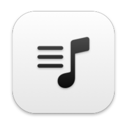
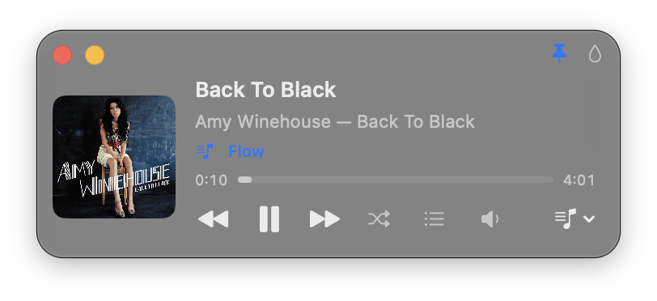

<p align="center">
  
</p>

<h1 align="center">MiniDeck</h1>

<p align="center">
  A tiny, playlist-focused mini player for Apple Music on macOS.<br>
  Native Swift + SwiftUI · No Electron · No API keys · Talks to Music.app directly.
</p>

<p align="center">
  
</p>

---

## Why

Apple Music's own MiniPlayer hides its controls until you hover, and there's no quick way to switch playlists from it.
Third-party clients like Cider or Sidra rebuild the whole app; I just wanted a small, glanceable deck that:

- **always shows** previous / play / next — no hover, no hunting;
- lets me **pick a playlist** from the player itself;
- floats on top, looks at home on modern macOS, and stays out of the way.

MiniDeck doesn't stream anything itself. It's a remote control for the Music app you already have, so your library,
Apple Music subscription, AirPlay, EQ and lossless settings all keep working exactly as before.

## Features

**Player**
- Always-on transport controls: previous, play/pause, next
- Album art (from Music, with an online fallback when Music has none), title, artist and album
- Live progress bar — drag it to seek
- Shuffle toggle that reflects Music's real state
- **Volume for Music only** (not the Mac's): click the speaker for a slider, scroll over it to adjust, Option-click to mute
- "Playing from" line showing the current playlist

**Playlists**
- Playlist picker menu with a checkmark on the one that's playing
- Optional **song list** under the player that follows along and jumps to the current song; double-click to play any song

**Window**
- Borderless panel that lives on every Space, with a **pin button** to keep it always on top (or not)
- **Liquid Glass** background on macOS 26 (clear or frosted), or the classic dark blur — one-click toggle next to the pin
- Built-in close / minimize buttons, Dock icon, ⌘Q
- Remembers its position

**Lifecycle**
- Starts Music **hidden in the background** — you never have to see the big window
- Optionally quits Music when you quit MiniDeck
- **Resumes where you left off**: the last song and position are restored, paused, until you press play
- Loading indicator while Music wakes up instead of a confusing "Not playing"

**Light on resources**: Music announces song changes itself, so MiniDeck only checks in every few seconds and stops redrawing when it is out of sight.

Everything else lives in the right-click menu.

## Requirements

- macOS 14 Sonoma or later (Liquid Glass needs macOS 26)
- Apple's Music app
- To build: Xcode **or** just the Command Line Tools (`xcode-select --install`)

## Download

Grab the latest **MiniDeck-x.y.zip** from [Releases](https://github.com/eftalor/MiniDeck/releases/latest), unzip it,
drag **MiniDeck.app** into Applications and open it. It isn't notarized, so the first time use right-click → **Open**
(or *System Settings → Privacy & Security → Open Anyway*).

## Build & install

```sh
git clone https://github.com/eftalor/MiniDeck.git
cd MiniDeck
./build.sh --install     # universal app (Apple Silicon + Intel) into ~/Applications
```

`build.sh` without `--install` leaves `MiniDeck.app` and `dist/MiniDeck.zip` in the project folder.

On first launch macOS asks whether MiniDeck may control **Music** — allow it.
If you said no by accident: *System Settings → Privacy & Security → Automation → MiniDeck → Music*.

The app is ad-hoc signed, not notarized. If you copy the zip to another Mac, right-click → **Open** the first time.

### Releasing

The version lives in `VERSION`. GitHub Actions builds every push on macOS 26 with Xcode 26; a version tag
also publishes a release. To publish a new version (updates `VERSION`, tags, pushes, then follows the build):

```sh
./release.sh 0.24 "What changed"
```

## How it works

| Piece | What it does |
|---|---|
| `MusicBridge.swift` | Talks to Music.app: compiled AppleScript on a serial queue for queries, raw Apple Events for the transport buttons so they never wait behind a slow query |
| `PlayerModel.swift` | State, polling, Music's `playerInfo` notifications for instant track changes, resume, artwork fallback |
| `PlayerView.swift` | The SwiftUI player, glass background, playlist menu |
| `TrackListView.swift` | The optional song list |
| `main.swift` | The floating borderless panel and app lifecycle |
| `icon/make-icon.swift` | Draws the app icon (`swift icon/make-icon.swift`) |

A debug log is written to `~/Library/Logs/MiniDeck.log`.

### Known limits

- **AutoPlay and AutoMix** aren't exposed to scripting by Music, so MiniDeck can't show or toggle them.
- Album-art fallback uses the public iTunes Search API (only the artist/album names are sent).

## Roadmap

Ideas, not promises:

- Repeat button
- Keyboard shortcuts / media keys
- Compact "controls only" mode
- Album art in the song list

## Credits

Vibe-coded with [Claude Code](https://claude.com/claude-code).
